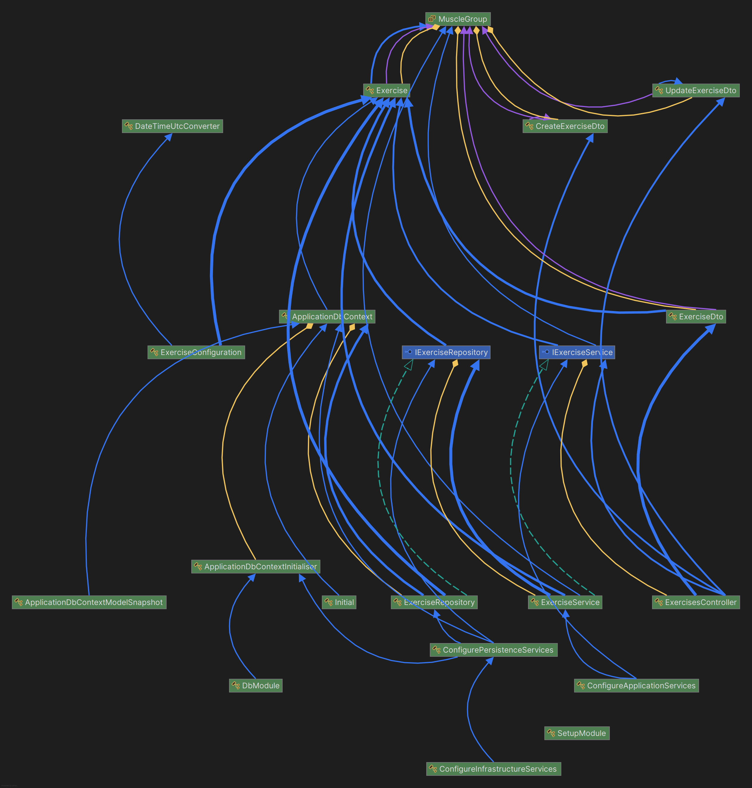

# Лабораторна робота №1. Web API на ASP.NET Core з багатошаровою архітектурою

## Тема: Спортзал (Сутність: `Exercise`)

# Мета роботи:
Навчитися створювати Web API на .NET 10 з багатошаровою архітектурою
(Domain → Application → Infrastructure → Api).
Зрозуміти, навіщо відокремлювати бізнес-логіку від способу зберігання
даних.
Опанувати впровадження залежностей (DI) і життєві цикли сервісів.
Підключити реляційну базу даних PostgreSQL за допомогою Entity
Framework Core і міграцій.

---

## Ендпоінти API (`/exercises`)

| Метод     | Шлях              | Опис                          | Відповіді |
|-----------|-------------------|-------------------------------|-----------|
| `GET`     | `/exercises`      | Отримання списку всіх вправ   | 200 OK |
| `GET`     | `/exercises/{id}` | Отримання вправи за ID        | 200 OK, 404 Not Found |
| `POST`    | `/exercises`      | Створення нової вправи        | 201 Created, 400 Bad Request, 409 Conflict |
| `PUT`     | `/exercises/{id}` | Оновлення існуючої вправи     | 200 OK, 400 Bad Request, 404 Not Found, 409 Conflict |
| `DELETE`  | `/exercises/{id}` | Видалення вправи              | 204 No Content, 404 Not Found |

---

### Table "public.exercises"

| Column | Type | Collation | Nullable | Default |
|--------|------|-----------|----------|---------|
| id | uuid | | not null | |
| name | character varying(255) | | not null | |
| calories_per_hour | numeric(10,2) | | not null | |
| requires_equipment | boolean | | not null | |
| muscle_group | character varying(50) | | not null | |
| created_at | timestamp with time zone | | not null | timezone('utc'::text, now()) |

**Indexes:**
* `"pk_exercises" PRIMARY KEY, btree (id)`
* `"ix_exercises_name" UNIQUE, btree (name)`

## Граф залежностей
