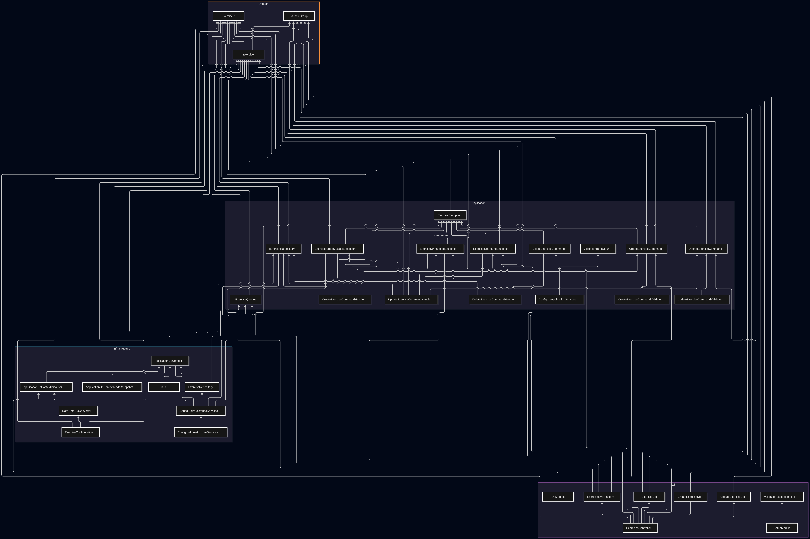

# Лабораторна робота №2. Web API на ASP.NET Core з багатошаровою архітектурою

## Тема: Спортзал (Сутність: `Exercise`)

# Мета роботи:

### Навчитися розділяти операції запису (команди) та читання (запити) за принципом CQRS.

### Опанувати MediatR: команди, обробники та конвеєр обробки запиту (pipeline behaviours).

### Перенести валідацію вхідних даних у шар Application за допомогою FluentValidation.

### Зрозуміти, навіщо повертати помилки як значення ( Option<T> , Either<L,R> з LanguageExt), а не через null і винятки.

### Запровадити строго типізовані ідентифікатори сутностей.

---

| Step | Action                                    | Method / URL             | Expected HTTP code |                    Actual result                    |
| ---- | ----------------------------------------- | ------------------------ | :----------------: | :-------------------------------------------------: |
| 1    | Get the list of exercises at the start    | `GET /exercises`         |       200 OK       |             `200 OK` (empty list `[]`)              |
| 2    | Try to get a non-existent exercise        | `GET /exercises/{guid}`  |   404 Not Found    |                   `404 Not Found`                   |
| 3    | Create a new valid exercise               | `POST /exercises`        |    201 Created     |    `201 Created` (`Location` header + DTO body)     |
| 4    | Try to create a duplicate by name         | `POST /exercises`        |    409 Conflict    |                   `409 Conflict`                    |
| 5    | Try to create an invalid exercise         | `POST /exercises`        |  400 Bad Request   |    `400 Bad Request` (list of validation errors)    |
| 6    | Successfully update an exercise           | `PUT /exercises/{id}`    |       200 OK       |              `200 OK` (updated fields)              |
| 7    | Delete an exercise                        | `DELETE /exercises/{id}` |   204 No Content   |                  `204 No Content`                   |
| 8    | Try to update a non-existent exercise     | `PUT /exercises/{guid}`  |   404 Not Found    | `404 Not Found` (`Exercise not found under id ...`) |
| 9    | Try to delete an already deleted exercise | `DELETE /exercises/{id}` |   404 Not Found    |                   `404 Not Found`                   |

```
Build started...
Build succeeded.
No changes have been made to the model since the last migration.
```


